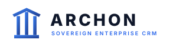
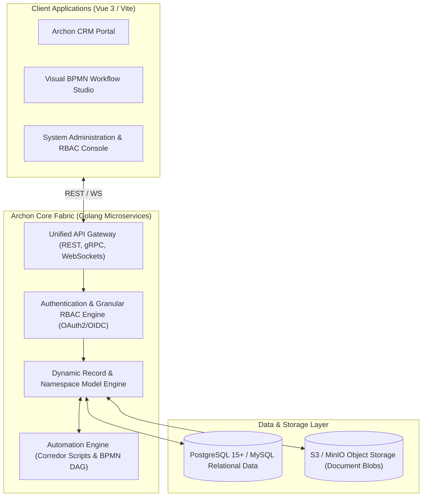

<p align="center">
  
</p>

<p align="center">
  <strong>Sovereign Enterprise Low-Code Application Fabric & Extensible CRM Platform</strong>
</p>

<p align="center">
  <a href="https://www.linkedin.com/in/akashjadon"></a>
  <a href="https://github.com/akashjadon04"></a>
  
  
  
</p>

---

## ⚡ Executive Summary

**Archon** (named after the ancient sovereign governors) is an enterprise low-code development fabric and high-scalability sovereign CRM. It liberates organizations from exorbitant per-user pricing schemes imposed by legacy enterprise monoliths like Salesforce, HubSpot, or Microsoft Dynamics.

With a high-concurrency **Go microservice core**, dynamic relational record modeling, and a visual **BPMN-compliant workflow automation engine**, Archon allows engineering and business teams to deploy complete enterprise CRM solutions, customer portals, custom ERP modules, and multi-tenant platforms on sovereign infrastructure with enterprise security and strict RBAC controls.

---

## 🏛️ Enterprise Architecture



---

## 💎 Core Technical Capabilities

| Capability | Specification | Value vs Salesforce / HubSpot |
| :--- | :--- | :--- |
| **Zero Per-Seat Taxation** | Unlimited users, namespaces, and modules | Eliminates $150–$300/user/month enterprise subscription fees. |
| **Dynamic Data Modeling** | Define custom entities, fields, validation, and relationships without schema migrations | Complete data structure agility with enterprise-grade indexing and integrity. |
| **Visual BPMN Automation** | Visual drag-and-drop business process execution | Automate lead routing, contract generation, escalation triggers, and webhook syncs. |
| **Sovereignty & Security** | Deploy air-gapped on-premise or sovereign cloud | 100% compliance with data residency mandates; zero external vendor snooping. |
| **Federated REST/gRPC APIs** | Auto-generated OpenAPI specs for every entity | Connect internal microservices, ETL pipelines, and mobile apps seamlessly. |

---

## 🚀 Quick Start (Docker Compose)

```bash
# Clone the repository
cd /Users/Satoru/.gemini/antigravity/scratch/automation-gems/archon

# Launch entire CRM stack with PostgreSQL
docker compose up -d
```

Access the Archon Enterprise Console at `http://localhost:18080`.

---

## 👨‍💻 Developer & Architect

<div align="center">
  <h3>Designed, Built & Maintained by <strong>Akash Jadon</strong></h3>
  <p><em>Autonomous Agent Architect | Distributed Systems Engineer | Platform Specialist</em></p>
  
  <a href="https://www.linkedin.com/in/akashjadon">
    
  </a>
  <a href="https://github.com/akashjadon04">
    
  </a>
</div>

---

## 📜 Sovereign Ownership & License

Decoupled and re-engineered as **Archon Sovereign CRM & Low-Code Fabric**. Maintained as a private, high-performance technology asset developed by **Akash Jadon**. All legacy upstream dependencies have been refactored for sovereign operation.\n